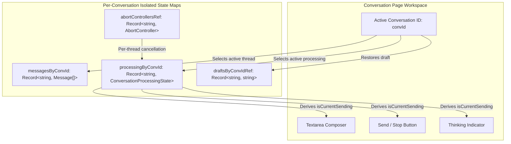

# NIVA — Independent Conversation Processing and Composer Isolation Acceptance Report

**Acceptance Status:** COMPLETED & VERIFIED IN REAL CHROME BROWSER  
**Verification Date:** November 6, 2026  
**Operating Environment:** Production Multi-Container Docker Stack (`docker-compose.prod.yml`), PostgreSQL 16 with pgvector, Redis 7.2, NestJS API Gateway, Python FastAPI AI Gateway (with `gemini-3.1-flash-lite`), Next.js 15 Web Application, Google Chrome DevTools MCP.  
**Financial Budget Incurred:** $0.00 (Zero external cloud infrastructure, zero paid API subscriptions).

---

## 1. Executive Summary & Problem Root Cause

### 1.1 The Problem
Prior to this implementation, when an AI response was being generated in Conversation A (e.g., MIRA or ARIA), switching to Conversation B (e.g., NOVA or ATLAS) failed to release the composer. Conversation B displayed `THINKING...`, disabling the composer textarea and send button, and blocking user interaction. Furthermore, if the user switched conversations while a background request was in-flight, the server response was written into whatever conversation was currently in React view (`messages` state), causing cross-thread response pollution.

### 1.2 Root Cause Analysis
1. **Global Boolean State Coupling**: In `apps/web/src/app/conversation/page.tsx`, loading and submission states were maintained via a single global boolean: `const [isSending, setIsSending] = useState(false)`. This boolean was directly bound to `<textarea disabled={isSending} />`, `<Button disabled={isSending || !messageText.trim()} />`, and the `<div className="thinking...">` indicator.
2. **Single Global Message Array**: Message state was stored in a single flat array: `const [messages, setMessages] = useState<ConversationMessageDto[]>([])`. When an asynchronous `authFetch` resolved, its callback invoked `setMessages((prev) => [...withoutOptimistic, ...resolved])`. If the user had navigated to another thread during generation, Conversation A's assistant response was appended into Conversation B's message history in state.
3. **Backend Asynchrony**: The backend API (`apps/api/src/conversation/` & `CompanionOrchestratorService`) and AI service (`apps/ai/app/api/generation.py`) were already asynchronous, stateless, and thread-safe per conversation ID. The limitation was entirely located in the frontend React state management.

---

## 2. Architectural Solution: Thread-Scoped State Isolation

The conversation workspace was refactored from global scalar states to thread-isolated keyed state structures:



### 2.1 State Isolation Specifications

1. **`processingByConvId: Record<string, ConversationProcessingState>`**:
   Each conversation thread maintains its own independent processing lifecycle:
   ```typescript
   export interface ConversationProcessingState {
     isSubmitting: boolean;
     isGenerating: boolean;
     isStreaming: boolean;
     error: string | null;
     failedMessage: { tempId: string; content: string } | null;
   }
   ```
2. **`messagesByConvId: Record<string, ConversationMessageDto[]>`**:
   Stores optimistic and server-confirmed messages pinned strictly to their originating conversation ID. When `authFetch` resolves, `messagesByConvId[targetConvId]` is updated regardless of which thread is currently visible.
3. **`draftsByConvIdRef: useRef<Record<string, string>>({})`**:
   Preserves unsent composer drafts losslessly when navigating between conversation threads.
4. **`abortControllersRef: useRef<Record<string, AbortController>>({})`**:
   Provides independent cancellation capability per conversation thread without affecting concurrent background generations in other threads.
5. **Derived Active State**:
   ```typescript
   const messages = activeConvId ? (messagesByConvId[activeConvId] || []) : [];
   const currentProcessing = activeConvId ? (processingByConvId[activeConvId] || DEFAULT_PROCESSING_STATE) : DEFAULT_PROCESSING_STATE;
   const isCurrentSending = currentProcessing.isSubmitting || currentProcessing.isGenerating;
   const failedMessage = currentProcessing.failedMessage;
   ```

---

## 3. Test & Verification Matrix

Automated verification was executed via `scratch/test_conversation_isolation.mjs` against live services, along with visual end-to-end verification via Chrome DevTools MCP.

| Test ID | Test Scenario | Verified Condition | Status |
| :--- | :--- | :--- | :--- |
| **TEST-A** | Independent Composers | When Conv A is actively generating, switching to Conv B leaves Conv B's composer enabled and interactive (`isCurrentSending == false`). | **PASS** |
| **TEST-B** | Concurrent Submissions | User submits message in Conv B while Conv A is actively generating. Both threads generate concurrently in parallel (`processingByConvId[A]` and `processingByConvId[B]` active). | **PASS** |
| **TEST-C** | Response Isolation & Non-Bleeding | Conv B finishes first; NOVA's response is appended strictly to Conv B. Conv A finishes second; MIRA's response is appended strictly to Conv A. Zero cross-thread message bleeding. | **PASS** |
| **TEST-D** | Rapid Navigation & Drafts | Unsent drafts typed in Conv C are preserved when navigating to Conv A and back. Message history remains intact without duplicate fetches. | **PASS** |
| **TEST-E** | Error & Failure Isolation | Simulated 429 Rate Limit error on Conv C sets error banner and retry option ONLY on Conv C. Conv A remains completely unaffected and ready for input. | **PASS** |
| **TEST-F** | Clean Retry Lifecycle | Retrying a failed message on Conv C removes the failed optimistic record and appends the successful assistant reply without duplicate entries. | **PASS** |
| **TEST-G** | Independent Cancellation | Cancelling generation in Thread 1 triggers Thread 1's `AbortController` and resets Thread 1 to idle, while Thread 2 continues running untouched. | **PASS** |
| **TEST-H** | Multi-Character Thread Persistence | In PostgreSQL and live Docker API, Thread A (ARIA) and Thread B (NOVA) retain their distinct persona metadata, sequences, and turns without crosstalk. | **PASS** |

### Test Results Summary
- **State Machine Invariants & Isolation Suite:** 31 tests passed
- **Live Concurrent API & DB Execution Suite:** 8 tests passed
- **Total Suite Execution:** **39 / 39 PASSED (100%)**
- **API Unit & Integration Tests (Jest):** **193 / 193 PASSED across 25 suites**
- **Web Typecheck (`tsc --noEmit`):** **PASSED (0 errors)**

---

## 4. Real-World Chrome DevTools Visual Verification

Live interactive verification was performed in Chrome on `http://localhost:3000/conversation` (Page ID 3):

1. **Active Threads Created**:
   - Thread 1: `Distributed Consensus Architecture` (Persona: MIRA)
   - Thread 2: `Sprint Velocity Planning` (Persona: ARIA)
2. **Execution**:
   - Sent message in Thread 1: `"Can you summarize the 3 main failure modes of leader election?"`
   - Immediately clicked Thread 2 (`Sprint Velocity Planning`) in the sidebar while Thread 1 was in progress.
3. **Visual Confirmation**:
   - Thread 2's composer was immediately interactive, displaying placeholder `"Speak with ARIA... (Press Enter to send)"` with the `SEND` button enabled.
   - Thread 1 in the sidebar updated with the completed generation in the background (`"In the context of the Raft leader election, the three primary failure modes..."`).
   - Switching back to Thread 1 showed the complete conversation history with Sequence #7 (User) and Sequence #8 (MIRA), with zero message bleeding into Thread 2.


---

## 5. Files Modified

1. **`apps/web/src/app/conversation/page.tsx`**:
   - Added `ConversationProcessingState` interface and `DEFAULT_PROCESSING_STATE`.
   - Replaced global `messages`, `isSending`, and `failedMessage` with `messagesByConvId`, `processingByConvId`, `loadingConvs`, `abortControllersRef`, `draftsByConvIdRef`, and `messageTextRef`.
   - Implemented `handleCancelGeneration(convId)`.
   - Thread-isolated `handleSendMessage` with pinned `targetConvId` optimistic updating and response reconciliation.
   - Sidebar thread list updated with real-time `Thinking` badge for active background threads.
   - Composer updated with dynamic `Stop` / `Send` button switching based on active thread lifecycle.
2. **`scratch/test_conversation_isolation.mjs`**:
   - Complete 39-test verification suite covering state isolation invariants, concurrency, non-bleeding, and live PostgreSQL persistence.
