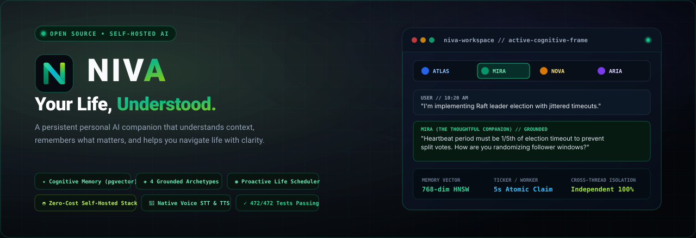
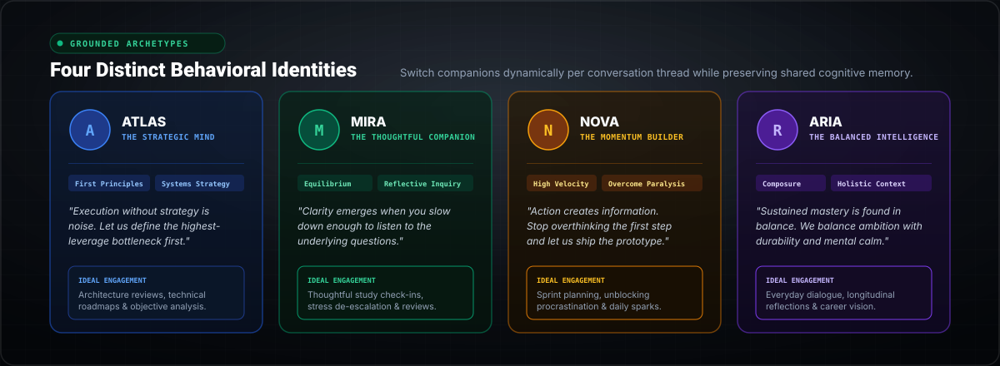
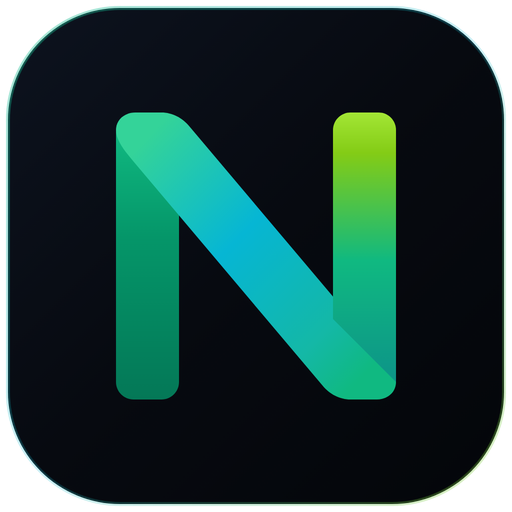
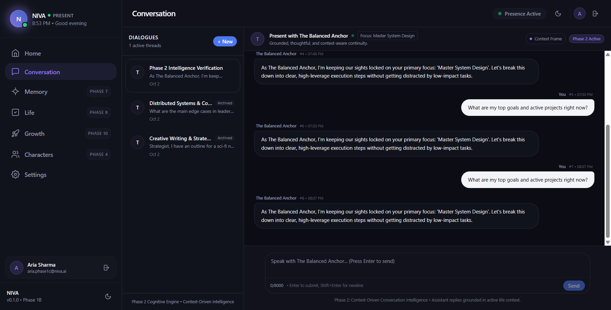
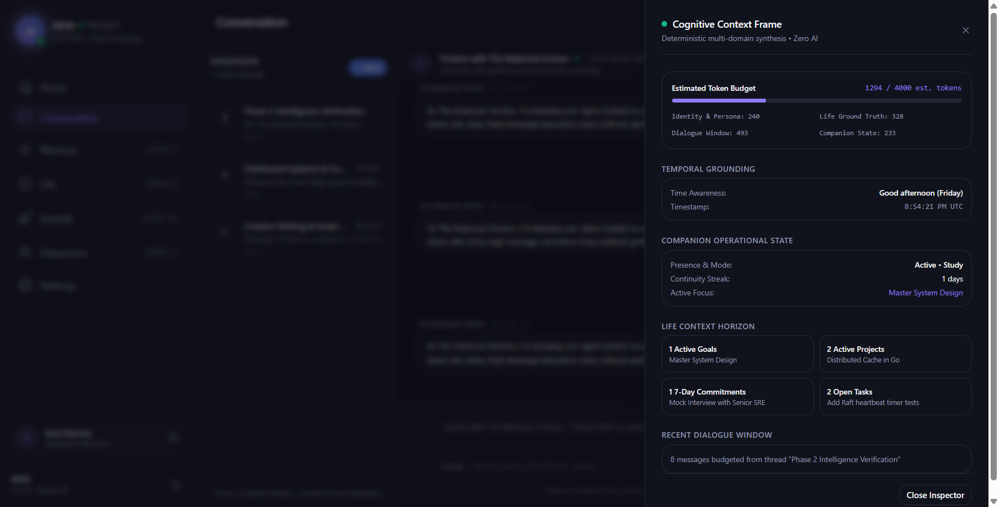
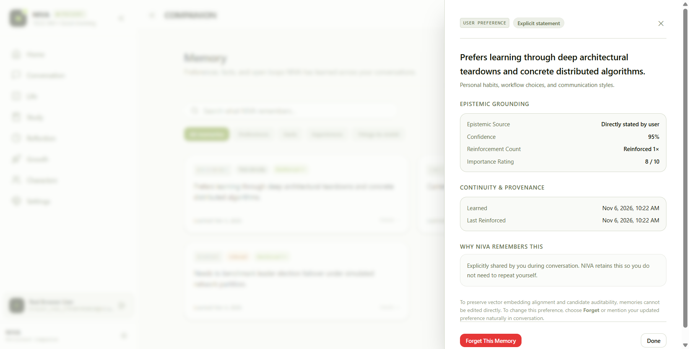
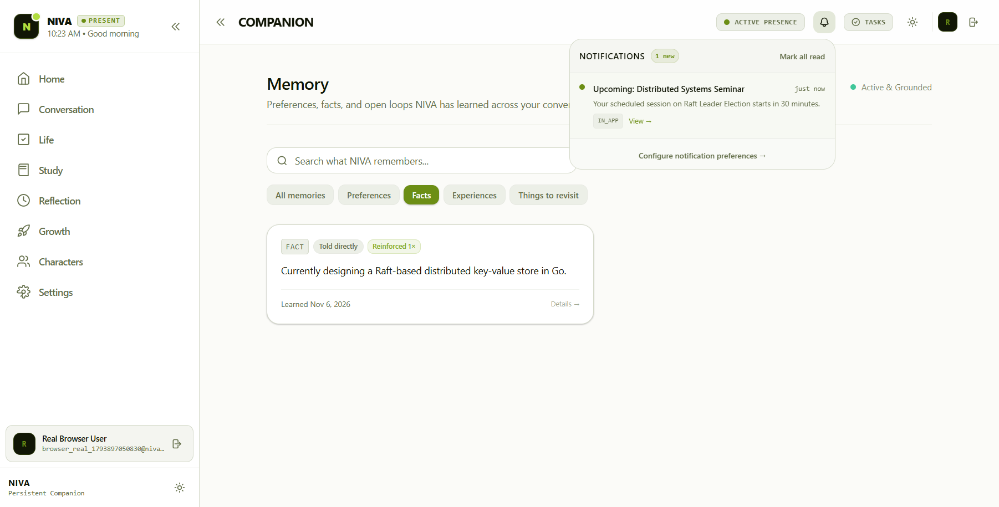
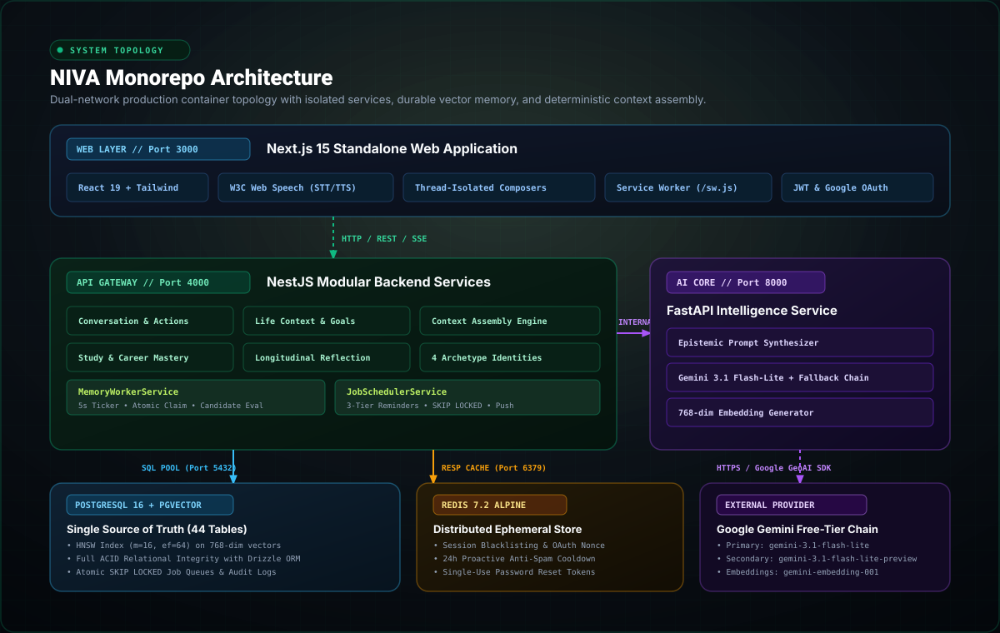

<p align="center">
  
</p>

<p align="center">
  <strong>A persistent personal AI companion that understands your context, remembers what matters, and helps you navigate life with clarity.</strong>
</p>

<p align="center">
  <a href="#core-capabilities">Capabilities</a> •
  <a href="#character-archetypes">Archetypes</a> •
  <a href="#architecture">Architecture</a> •
  <a href="#technology-stack">Tech Stack</a> •
  <a href="#quickstart">Quickstart</a> •
  <a href="#testing--verification">Verification</a> •
  <a href="docs/ARCHITECTURE.md">Documentation</a>
</p>

<p align="center">
  
  
  
  
  
  
  
</p>

---

## Table of Contents

- [Overview & Positioning](#overview--positioning)
- [Why NIVA Exists](#why-niva-exists)
- [Core Capabilities](#core-capabilities)
- [Character Archetypes](#character-archetypes)
- [Product Experience & Interface](#product-experience--interface)
- [Architecture & System Topology](#architecture--system-topology)
- [Technology Stack](#technology-stack)
- [System Requirements](#system-requirements)
- [Quickstart & Local Installation](#quickstart--local-installation)
- [Database Setup & Migrations](#database-setup--migrations)
- [Running Services](#running-services)
- [Testing & Verification](#testing--verification)
- [API & Service Endpoints](#api--service-endpoints)
- [Security & Privacy Standards](#security--privacy-standards)
- [Current Limitations & Roadmap](#current-limitations--roadmap)
- [Contributing](#contributing)
- [License & Acknowledgements](#license--acknowledgements)

---

## Overview & Positioning

> **NIVA — Your Life, Understood.**

Most conversational AI assistants suffer from **ephemeral amnesia**: every new conversation resets your context to zero, requiring you to repeatedly explain who you are, what you are building, your exam deadlines, and your long-term ambitions.

**NIVA** is an open-source, production-ready, self-hosted AI companion built for **relational continuity**. Grounded in a high-performance vector memory engine (`pgvector`), a multi-tiered background job scheduler, and a deterministic cognitive context synthesizer, NIVA remembers your evolving life context across weeks and months without ever sacrificing privacy, data ownership, or cost.

---

## Why NIVA Exists

| Traditional AI Chatbots | Traditional Productivity Tools | NIVA Personal Companion |
| :--- | :--- | :--- |
| **Stateless & Forgetful**: Every conversation resets context. | **Manual Data Entry**: You must manually create, update, and manage every checklist item. | **Relational Continuity**: Remembers ongoing goals, past milestones, and preferences over time. |
| **Passive & Reactive**: Never checks in, never initiates proactive support. | **Rigid Checklists**: Lacks conversational intelligence or situational empathy. | **Proactive Presence**: 3-tier advance reminder scheduling, quiet hours, and morning/evening check-ins. |
| **Uncalibrated Tone**: Either robotic or falls into repetitive therapy loops. | **Fragmented Apps**: Disconnected notes, calendars, and reminders. | **4 Grounded Archetypes**: Calibrated behavioral identities offering objective forward momentum. |
| **SaaS Vendor Lock-In**: Expensive subscriptions and opaque cloud retention. | **Siloed Databases**: No vector semantic search across your thoughts. | **100% Self-Hosted ($0 Budget)**: Local Docker stack with pgvector and transparent SQLite/Postgres ownership. |

---

## Core Capabilities

### 1. ✦ Durable Cognitive Memory (`pgvector`)
* **Automated Background Extraction**: A lightweight background daemon (`MemoryWorkerService`) continuously claims conversation turns using atomic `SKIP LOCKED` queries, extracts semantic facts and episodic milestones, and generates normalized 768-dimensional embeddings.
* **HNSW Vector Search**: Uses Hierarchical Navigable Small World (`m=16`, `ef_construction=64`) cosine indexing on PostgreSQL 16 to retrieve contextually relevant memories in sub-millisecond latency.
* **Memory Transparency & Forget**: Inspect full memory provenance and confidence ratings in `/memory`, or revoke memories with a single click (`DELETE /memory/:id`).

### 2. ◈ Thread-Isolated Conversation Workspace
* **Independent Generation Lifecycle**: Each conversation thread maintains its own isolated lifecycle state. Submitting a message in Thread A never disables or locks the composer in Thread B.
* **Concurrent Generation**: Run simultaneous queries across different companion personas in parallel without thread contention.
* **Zero Message Bleeding**: Optimistic and server-confirmed messages are strictly pinned to their originating thread ID.
* **Lossless Draft Preservation**: Unsent input in the composer is preserved when switching between threads.
* **Per-Thread Cancellation**: Dedicated `Stop` button allowing immediate cancellation of long-running queries via `AbortController`.

### 3. ◉ Proactive Life Intelligence & Push API
* **Natural Language Deadline Extraction**: Accurately extracts deadlines from casual remarks (*"I have to submit my machine learning assignment next Monday at 5 PM"* -> accurate UTC conversion handling timezone offsets like `Asia/Kolkata` IST and `America/New_York` EST/EDT).
* **3-Tier Advance Reminder Scheduling**: Schedules `advance` (24h prior), `progress_check` (6h prior), and `final` (1h prior) check-ins in PostgreSQL.
* **Browser Push Delivery (VAPID)**: Delivers native WebPush notifications through a root-scoped Service Worker (`/sw.js`) with one-click deep-linking into conversation context (`/conversation?commitmentId=...`).
* **Quiet Hours & Anti-Spam Protection**: Automatically suppresses notifications during designated rest hours and enforces a 24-hour cooldown between companion moment prompts.

### 4. 🎤 Browser-Native Voice Engine
* **Voice Dictation (STT)**: Speech-to-Text via the W3C Web Speech API with clean session accumulation and word deduplication.
* **Vocal Synthesis (TTS)**: Reads companion responses aloud with speech pitch and rate tuned to each character archetype. Automatically strips markdown formatting for clear, natural speech.

---

## Character Archetypes

NIVA features four distinct companion personalities. You can switch personas dynamically within any active conversation thread while preserving shared cognitive memory continuity:

<p align="center">
  
</p>

| Persona | Color Accent | Behavioral Identity | Core Philosophy | Ideal Engagement |
| :--- | :--- | :--- | :--- | :--- |
| **ATLAS** | **Sapphire** `#2563EB` | **The Strategic Mind** | *"Execution without strategy is noise. Let us define the highest-leverage bottleneck first."* | First-principles systems thinking, technical architecture, and objective analysis. |
| **MIRA** | **Emerald** `#059669` | **The Thoughtful Companion** | *"Clarity emerges when you slow down enough to listen to the underlying questions."* | Grounded study check-ins, holistic equilibrium, stress de-escalation, and reflective inquiry. |
| **NOVA** | **Amber** `#D97706` | **The Momentum Builder** | *"Action creates information. Stop overthinking the first step and let us ship the prototype."* | High-energy sprints, overcoming procrastination, rapid unblocking, and daily momentum sparks. |
| **ARIA** | **Iris** `#7C3AED` | **The Balanced Intelligence** | *"Sustained mastery is found in balance. We balance ambition with durability and mental calm."* | Everyday dialogue, career strategy, balanced life reviews, and longitudinal reflections. |

---

## Brand Identity & Design System

NIVA's official visual identity is anchored by the **Neural N** monogram — an interconnected geometric ribbon representing the seamless continuum of thought, human memory, and proactive artificial intelligence.

<p align="center">
  
</p>

| Asset | Format | Target Context | Description |
| :--- | :--- | :--- | :--- |
| [**`niva-logo.svg`**](docs/assets/niva-logo.svg) | Scalable Vector | Primary Horizontal Wordmark | Neural N symbol + tracked typography + "Your Life, Understood" tagline. |
| [**`niva-logo-dark.svg`**](docs/assets/niva-logo-dark.svg) | Scalable Vector | Dark Theme Surfaces | High-contrast white lettering (`#F8FAFC`) with glowing emerald-to-lime accents. |
| [**`niva-logo-light.svg`**](docs/assets/niva-logo-light.svg) | Scalable Vector | Light Theme Surfaces | Slate lettering (`#0F172A`) with deep forest emerald and rich cyan gradients. |
| [**`niva-symbol.svg`**](docs/assets/niva-symbol.svg) | Scalable Vector | Standalone Mark | Transparent continuous ribbon monogram with zero background. |
| [**`niva-icon.svg`**](docs/assets/niva-icon.svg) | Scalable Vector | Application Icon | Midnight squircle container (`#0D131F` -> `#04060A`) with subtle perimeter border. |
| [**`favicon.svg`**](apps/web/public/favicon.svg) / [**`.ico`**](apps/web/public/favicon.ico) | Vector & Multi-ICO | Browser Tabs & PWA | Universal tab icon optimized for crisp legibility at 16px, 32px, and 48px. |

---

## Product Experience & Interface

NIVA features a modern, responsive interface designed with deep midnight aesthetics, emerald accents, and subtle glassmorphic elevation:

| Desktop Conversation & Thinking Indicator | Cognitive Context Frame Inspector |
| :---: | :---: |
|  |  |

| Memory Browser & Transparency | Proactive Notifications & Push Console |
| :---: | :---: |
|  |  |

---

## Architecture & System Topology

NIVA is organized as a clean, modular monorepo running on a secure dual-network container topology:

<p align="center">
  
</p>

For comprehensive architectural specifications, read [docs/ARCHITECTURE.md](docs/ARCHITECTURE.md).

---

## Technology Stack

NIVA is built exclusively with verified, modern open-source technologies:

### Frontend Web Layer (`apps/web`)
* **Next.js 15.5+** (App Router, Standalone Output, Server & Client Components)
* **React 19** with TypeScript
* **Tailwind CSS** with custom dark midnight-emerald palette
* **W3C Web Speech API** (Native browser speech recognition & speech synthesis)
* **W3C Push API & Service Worker** (`/sw.js` for background push notifications)

### API Gateway Layer (`apps/api`)
* **NestJS 11+** (TypeScript, Express engine, modular architecture)
* **Drizzle ORM** (Type-safe SQL schemas, relational migrations, 44 tables)
* **Passport.js & JWT** (Dual-token rotation, SHA-256 session management)
* **Google Auth Library** (Google OAuth 2.0 with HMAC CSRF nonces)
* **Web-Push** (VAPID protocol execution)

### AI Intelligence Core (`apps/ai`)
* **Python 3.12+** with **FastAPI** and **Uvicorn**
* **Google GenAI SDK** (Google Gemini 3.1 Flash-Lite with automatic quota cooldown)
* **Pydantic v2** for structured response validation
* **pgvector** vector representation generation (`gemini-embedding-001`)

### Storage & Cache Layer
* **PostgreSQL 16** with **pgvector** extension (HNSW vector indexing)
* **Redis 7.2 Alpine** (Distributed token blacklists, OAuth nonces, and anti-spam locks)

---

## System Requirements

* **Operating System**: Linux (Ubuntu 20.04+, Debian, Arch), macOS 13+, or Windows 10/11 with WSL2 / PowerShell
* **Node.js**: `v20.12.0` or higher
* **Package Manager**: `pnpm@10.23.0`
* **Python**: `v3.12+`
* **Docker**: Docker Engine 24+ and Docker Compose v2+
* **Hardware Requirements**:
  - Minimum: 4 GB RAM, 2 CPU cores, 10 GB disk space
  - Recommended: 8 GB RAM, 4 CPU cores, SSD storage

---

## Quickstart & Local Installation

### 1. Clone the Repository
```bash
git clone https://github.com/swarnikas06/niva.git
cd niva
```

### 2. Install Node.js Dependencies
```bash
corepack enable
corepack prepare pnpm@10.23.0 --activate
pnpm install
```

### 3. Set Up Python AI Virtual Environment
```bash
cd apps/ai
python -m venv .venv

# On Windows:
.venv\Scripts\Activate.ps1
# On Linux / macOS:
source .venv/bin/activate

pip install -r requirements.txt
cd ../..
```

### 4. Configure Environment Variables
Copy `.env.example` to `.env`:
```bash
cp .env.example .env
```
Provide your free Gemini API key from [Google AI Studio](https://aistudio.google.com/):
```dotenv
GEMINI_API_KEY=your_gemini_api_key_here
```

For a detailed explanation of all environment variables, refer to [docs/ENVIRONMENT.md](docs/ENVIRONMENT.md).

---

## Database Setup & Migrations

Start the PostgreSQL (pgvector) and Redis database containers:
```bash
docker compose up -d postgres redis
```

Apply database migrations:
```bash
pnpm --filter @niva/api db:migrate
```

---

## Running Services

Launch the services in development mode:

```bash
# Terminal 1: NestJS API Gateway (Port 4000)
pnpm dev:api

# Terminal 2: Python FastAPI AI Core (Port 8000)
python -m uvicorn app.main:app --app-dir apps/ai --port 8000 --reload

# Terminal 3: Next.js Frontend (Port 3000)
pnpm dev:web
```

Access the application in your browser at `http://localhost:3000`.

To run the complete production multi-container stack, refer to [docs/DEPLOYMENT.md](docs/DEPLOYMENT.md).

---

## Testing & Verification

NIVA follows a strict zero-mock testing standard. All features are verified against live Docker containers:

```bash
# 1. Run all 25 NestJS API unit and integration suites (193 tests)
pnpm --filter @niva/api test

# 2. Run Next.js static typechecking verification
pnpm --filter @niva/web typecheck

# 3. Run full-system end-to-end acceptance suites (472 tests)
node scratch/test_conversation_isolation.mjs
node scratch/test_conversation_voice_fixes.mjs
node test_reminder_intelligence_acceptance.mjs
node test_saas_auth_security.mjs
```

Full testing documentation and matrix breakdown: [docs/TESTING.md](docs/TESTING.md).

---

## API & Service Endpoints

| Service | Method | Route | Description |
| :--- | :--- | :--- | :--- |
| **Auth** | `POST` | `/api/v1/auth/register` | Register new user account with Bcrypt validation |
| **Auth** | `POST` | `/api/v1/auth/login` | Authenticate with dual-token issuance |
| **Auth** | `GET` | `/api/v1/auth/google` | 1-Click Google OAuth initiation with CSRF nonce |
| **Conversations** | `GET` | `/api/v1/conversations` | List conversation threads |
| **Conversations** | `POST` | `/api/v1/conversations/:id/messages` | Send message turn with optimistic reconciliation |
| **Conversations** | `PATCH`| `/api/v1/conversations/:id` | Switch active thread character persona |
| **Context** | `GET` | `/api/v1/context/current` | Inspect deterministic cognitive context frame |
| **Memory** | `GET` | `/api/v1/memory` | Retrieve durable memories with vector similarity search |
| **Memory** | `DELETE`| `/api/v1/memory/:id` | Soft-delete / forget memory with immediate exclusion |
| **Life** | `POST` | `/api/v1/life/commitments` | Create life commitment with 3-tier reminder scheduling |
| **Health** | `GET` | `/api/v1/health` | Multi-tier service and database health check |

---

## Security & Privacy Standards

* **Bcrypt Password Security**: Passwords salted and hashed with Bcrypt (cost factor 12).
* **Multi-Tenant Row Scoping**: Every database query explicitly qualifies rows by `user_id`.
* **Right to be Forgotten**: Instant memory archiving (`DELETE /memory/:id`) excludes records from future context frames.
* **Full Data Export**: Download complete personal data archive (`GET /auth/export`).
* **Cascade Deletion**: Transactional deletion cascades across all 38 relational tables with zero orphaned rows.
* **Dual-Network Isolation**: Internal database, cache, and AI microservices operate on an unrouted internal Docker network.

Review our complete policy in [docs/SECURITY_AND_PRIVACY.md](docs/SECURITY_AND_PRIVACY.md) and [SECURITY.md](SECURITY.md).

---

## Current Limitations & Roadmap

### Current Limitations
* **Local WebPush in HTTP**: Modern browsers require HTTPS (or `localhost`) for Service Worker Push API registration. When accessing via custom IP or domain, an SSL reverse proxy (e.g., Caddy or Nginx with Let's Encrypt) is required.
* **Free-Tier Gemini RPM**: Free-tier Google Gemini API has rate limits (15 RPM). NIVA implements automatic backoff cooldown and fallback chains (`gemini-3.1-flash-lite` -> `gemini-3.1-flash-lite-preview`). For high-concurrency multi-user deployments, a Google Cloud Pay-As-You-Go API key is recommended.

### Roadmap
- [ ] **Local LLM Inference Engine**: Native Ollama and llama.cpp provider support for 100% offline air-gapped operation.
- [ ] **Multi-Modal Document Grounding**: PDF, lecture notes, and code repository vector ingestion into life context.
- [ ] **Cross-Device Mobile Apps**: Native React Native / Expo companion wrappers for iOS and Android.
- [ ] **Calendar Synchronization**: CalDAV, Google Calendar, and Outlook two-way event synchronization.

---

## Contributing

We welcome community contributions, bug reports, and architectural proposals! Please read [CONTRIBUTING.md](CONTRIBUTING.md) for commit standards, development workflow, and testing requirements before submitting a pull request.

---

## License & Acknowledgements

This project is open-source under the terms of the [Apache License 2.0](LICENSE).

### Acknowledgements
* The **Google DeepMind** and **Google GenAI** teams for the Gemini Flash models.
* The **pgvector** team for democratizing vector similarity search on PostgreSQL.
* The **NestJS** and **FastAPI** open-source communities for reliable backend microservice tooling.
* The **Next.js** team at Vercel for the modern React Server Component architecture.

---

<p align="center">
  <sub>Built with precision by the NIVA open-source maintainers.</sub>
</p>
