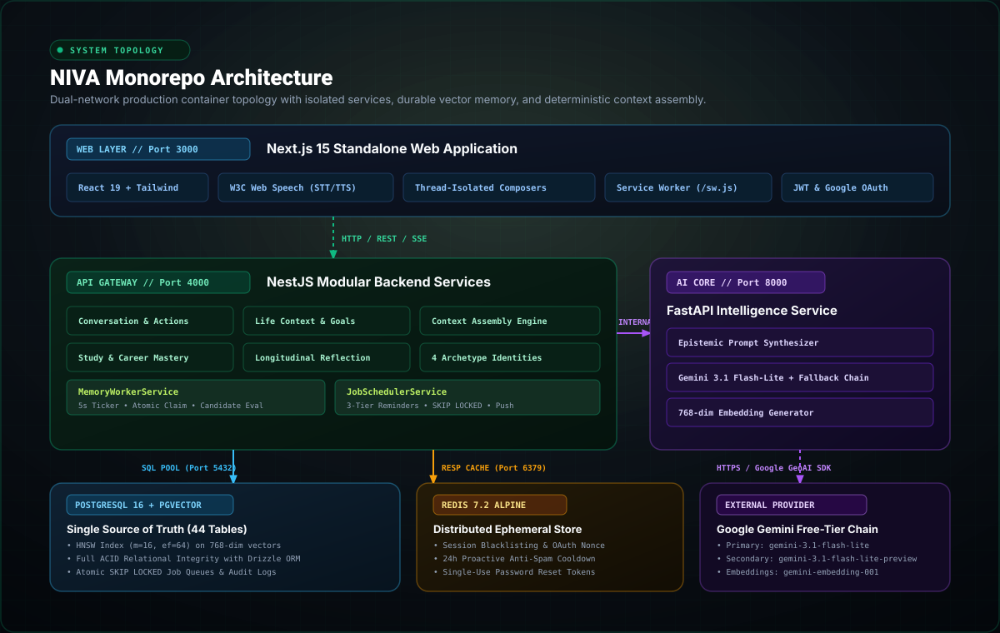
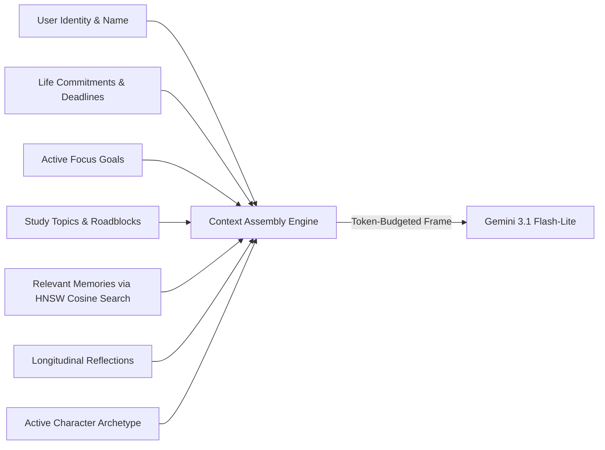

# NIVA System Architecture

This document provides a comprehensive technical overview of **NIVA (Your Life, Understood)**, a persistent personal AI companion engineered for relational continuity, contextual memory, and proactive presence.



---

## 1. High-Level Architectural Principles

NIVA is designed around four foundational architectural tenets:

1. **Relational Continuity Over Ephemeral Chat**: Conversations are not isolated stateless sessions. NIVA maintains durable long-term memory across sessions, goals, projects, and life events.
2. **Deterministic Context Assembly**: Raw user data is never blindly dumped into LLM prompts. A dedicated context engine deterministically synthesizes identity, life commitments, active goals, study roadblocks, and relevant memories within a strict token budget.
3. **Dual-Network Isolation**: Production containers operate on two isolated Docker networks. The database, Redis, and internal AI endpoints are inaccessible from external networks.
4. **$0 Operating Cost Local Self-Hosting**: All components (PostgreSQL with pgvector, Redis, NestJS, FastAPI, Next.js) run fully containerized on commodity hardware using standard local Docker and free-tier AI inference with automatic fallback chains.

---

## 2. Monorepo Topology & Services

```
niva/
├── apps/
│   ├── web/           # Next.js 15 Standalone Web Application (Port 3000)
│   ├── api/           # NestJS Modular Backend Gateway (Port 4000)
│   └── ai/            # Python FastAPI Intelligence & Embedding Service (Port 8000)
├── packages/
│   ├── shared-types/  # Shared TypeScript interfaces & DTOs across Web & API
│   └── validation/    # Shared Zod validation schemas & environment parsers
├── docs/              # System documentation, design decisions & SVG assets
├── infrastructure/    # PostgreSQL migrations, Docker configurations & scripts
└── docker-compose.prod.yml  # Multi-container production deployment specification
```

---

## 3. Tier-by-Tier System Breakdown

### Tier 1: Client Presentation (`apps/web`)
* **Framework**: Next.js 15.5+ (React 19, App Router, Standalone Output).
* **Styling**: Tailwind CSS with custom midnight-emerald palette and Flashform design tokens.
* **Thread-Isolated Processing**:
  - Independent conversation state maps (`messagesByConvId`, `processingByConvId`, `loadingConvs`, `draftsByConvIdRef`, `abortControllersRef`).
  - Switching threads never locks inactive composers or causes cross-thread response pollution.
  - In-flight background generation displays a real-time `Thinking...` pulse indicator in the thread drawer.
  - Dedicated per-thread generation cancellation via dynamic `Stop` controls.
* **Browser-Native Voice Engine**:
  - Speech-to-Text (STT) via W3C Web Speech API with session accumulator and deduplication buffer.
  - Text-to-Speech (TTS) via Web Speech Synthesis with per-character vocal tuning and automatic markdown stripping.
* **PWA & Proactive Push**:
  - Root-scoped Service Worker (`/sw.js`) with WebPush notification handler and deep-link click routing (`/conversation?commitmentId=...`).
  - Web App Manifest (`manifest.json`) supporting desktop and mobile installation.

### Tier 2: API Gateway & Orchestration (`apps/api`)
* **Framework**: NestJS 11+ (TypeScript, Express engine, modular architecture).
* **Core Domains**:
  - `AuthModule`: Email/password (Bcrypt cost 12), Google OAuth 2.0 (CSRF state verification, Redis single-use nonce), JWT access & refresh token rotation, cascade GDPR account deletion.
  - `ConversationModule`: Multi-thread dialogue persistence, turn sequencing, optimistic message reconciliation, and in-thread persona switching (`PATCH /conversations/:id`).
  - `LifeContextModule`: Goals, Projects, Tasks, Ideas, and Commitments CRUD with deterministic deadline extraction.
  - `StudyModule`: Coursework, technical topics, mastery levels, roadblock tracking, and career skill cross-linkage.
  - `CareerModule`: Placement readiness scoring, interview simulator, and skill progression radar.
  - `ReflectionModule`: Longitudinal reflection engine with windowed analysis (7d, 14d, 30d) and explicit user observation correction.
  - `MemoryModule`: Memory browser, semantic search, provenance inspection, and explicit forgetting (`DELETE /memory/:id`).
* **Integrated Background Daemons**:
  - `MemoryWorkerService`: 5-second atomic ticker (`FOR UPDATE SKIP LOCKED`) claiming unextracted conversation jobs, triggering candidate evaluation in the AI service, generating 768-dim embeddings, and deduplicating memories.
  - `JobSchedulerService`: 5-second atomic job scheduler managing 3-tier advance reminder scheduling (`advance`, `progress_check`, `final`), quiet hours suppression, and WebPush dispatch.

### Tier 3: AI Intelligence Service (`apps/ai`)
* **Framework**: Python 3.12+ (FastAPI, Uvicorn, Pydantic v2).
* **Inference Pipeline**:
  - Epistemic Prompt Synthesizer: Enforces character persona directives, casual brevity, structured problem solving, emotional containment, and anti-therapy validation loop bans.
  - Provider Abstraction: Direct integration with Google GenAI SDK.
  - Resilience & Quota Cooldown: Transparent fallback chain between `gemini-3.1-flash-lite`, `gemini-3.1-flash-lite-preview`, and standard models with automatic 60s cooldown handling on HTTP 429 errors.
  - Vectorization: Generates normalized 768-dimensional embeddings (`gemini-embedding-001`).

### Tier 4: Data & Vector Persistence
* **PostgreSQL 16 + pgvector**:
  - Relational Single Source of Truth (44 tables managed by Drizzle ORM).
  - HNSW vector index (`m=16`, `ef_construction=64`) on `memory_embeddings` using cosine distance operator `<=>`.
  - Atomic row locking (`FOR UPDATE SKIP LOCKED`) for distributed job execution.
* **Redis 7.2 Alpine**:
  - Session revocation blacklists and refresh token rotation.
  - Single-use Google OAuth state tokens (10-minute TTL).
  - 24-hour proactive notification anti-spam cooldown and active dialogue suppression (5m window).

---

## 4. The Cognitive Context Assembly Engine

NIVA never provides ungrounded LLM inference. When a message is sent, `ContextAssemblyService` synthesizes an 8-domain cognitive frame:



1. **User Identity**: Preferred name, academic background, career trajectory.
2. **Current Focus**: The user's single primary active goal.
3. **Commitments**: Impending deadlines within 72 hours, sorted by urgency and priority.
4. **Recent Study Roadblocks**: Technical friction points recorded in study sessions.
5. **Episodic & Semantic Memories**: Retrieved via HNSW vector similarity search against the current turn content, thresholded at cosine similarity $\ge 0.72$.
6. **Persona Directives**: Behavioral style parameters for the active archetype.
7. **Token Budgeting**: Strict 4,000-token allocation guaranteeing fast generation latency.

---

## 5. Security & Network Architecture

### Dual-Network Isolation Topology
```
[ Browser / Internet ]
         │ (HTTP :3000 / :4000)
         ▼
┌────────────────────────────────────────────────────────┐
│ niva-egress-network (External Access)                  │
│                                                        │
│  ┌──────────────────┐          ┌───────────────────┐   │
│  │  niva-prod-web   │          │   niva-prod-api   │   │
│  │  (Next.js :3000) │          │   (NestJS :4000)  │   │
│  └──────────────────┘          └─────────┬─────────┘   │
└──────────────────────────────────────────┼─────────────┘
                                           │
┌──────────────────────────────────────────┼─────────────┐
│ niva-backend-network (internal=true)     │             │
│                                          │             │
│  ┌──────────────────┐          ┌─────────▼─────────┐   │
│  │   niva-prod-ai   │◄─────────┤ niva-prod-postgres│   │
│  │  (FastAPI :8000) │          │  (Postgres :5432) │   │
│  └──────────────────┘          └─────────┬─────────┘   │
│                                          │             │
│                                ┌─────────▼─────────┐   │
│                                │  niva-prod-redis  │   │
│                                │   (Redis :6379)   │   │
│                                └───────────────────┘   │
└────────────────────────────────────────────────────────┘
```

* **Service-to-Service Secret Authentication**: Internal communication between `niva-prod-api` and `niva-prod-ai` requires a shared secret header (`X-Niva-Internal-Secret`). Requests lacking this header are rejected with HTTP 401.
* **Non-Root Execution**: All container workloads execute under unprivileged user IDs (`UID 1001 / nextjs` and `UID 1001 / nodejs`).
* **Zero Secrets in Image Layers**: Environment secrets are injected exclusively at runtime via Docker environment files; images contain zero hardcoded credentials.
