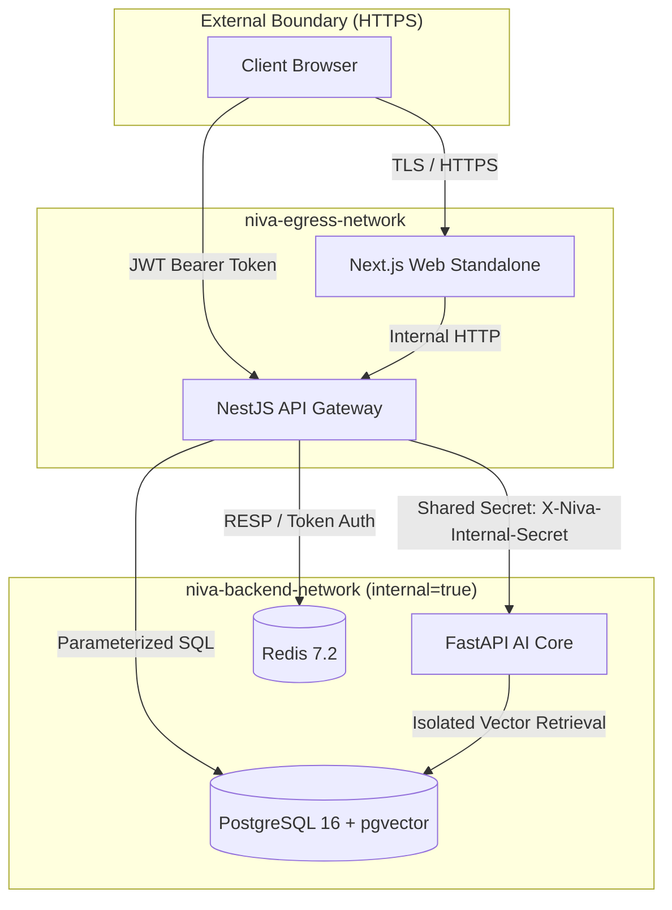

# NIVA Security and Privacy Architecture

This document describes the security guarantees, privacy protections, and threat model implemented across NIVA.

---

## 1. Security Architecture & Threat Model

NIVA is built with a zero-trust perspective regarding multi-tenant data access, user privacy, and internal service communication.



---

## 2. Authentication & Authorization

### 2.1 Password Hashing & Credentials
* Passwords are salted and hashed using **Bcrypt with a cost factor of 12**.
* Plaintext passwords are never logged, persisted, or passed beyond the authentication service boundary.
* Password criteria enforcement (minimum 8 characters, requiring uppercase, lowercase, numbers, and symbols).

### 2.2 Dual-Token Authentication Lifecycle
* **Access Tokens**: Short-lived (15 minutes), signed with `HS256` using `JWT_SECRET`. Contains minimal payload (`userId`, `email`).
* **Refresh Tokens**: Long-lived (30 days), cryptographically random tokens stored as SHA-256 hashes in the PostgreSQL `sessions` table.
* **Token Rotation**: Each refresh request atomically invalidates the old token and issues a new pair. Replaying an old refresh token immediately revokes all active user sessions as a suspected compromise.
* **Instant Revocation**: User logout or password changes immediately write token identifiers to Redis blacklists, causing all in-flight requests to fail verification.

### 2.3 Google OAuth 2.0 Hardening
* **CSRF State Verification**: Login requests generate an HMAC-signed cryptographic state token validated on the OAuth callback.
* **Nonce Protection**: Nonce values are stored in Redis with a 10-minute TTL and single-use consumption semantics to completely prevent replay attacks.

---

## 3. Multi-Tenant Data Isolation & IDOR Prevention

* **Strict Row-Level Scoping**: Every database query across all 44 tables explicitly qualifies rows by `user_id`:
  ```typescript
  // Example from LifeContextService
  const [task] = await this.db
    .select()
    .from(lifeTasks)
    .where(and(eq(lifeTasks.id, taskId), eq(lifeTasks.userId, user.id)))
    .limit(1);
  ```
* Cross-tenant access attempts return standard HTTP 404 (Not Found) rather than 403 to prevent resource enumeration.
* Multi-tenant isolation is verified by automated acceptance tests (`test_security_acceptance.mjs`).

---

## 4. User Privacy & GDPR Compliance

NIVA implements user privacy rights as core product features:

### 4.1 Memory Transparency
Users have full visibility into what NIVA has remembered:
* The `/memory` interface exposes all extracted memories with category tags (Fact, Preference, Goal, Habit), confidence metrics (0.0 to 1.0), and conversation provenance.

### 4.2 Right to be Forgotten (`DELETE /memory/:id`)
* When a user clicks **Forget** on a memory, the system immediately changes its database status to `archived` and sets `is_active = false`.
* Archived memories are excluded from vector similarity searches and context frame assemblies with immediate effect.

### 4.3 Complete Data Export (`GET /auth/export`)
* Users can download a single comprehensive `.json` file containing their full account profile, conversation transcripts, goals, tasks, study topics, and memories directly from Settings.

### 4.4 Cascade Account Deletion (`DELETE /auth/account`)
* Account deletion requires password verification and explicit confirmation (`"DELETE"`).
* The deletion executes atomically within a PostgreSQL transaction, cascading across all 38 relational tables (`ON DELETE CASCADE`). Zero orphaned records remain in the database.

---

## 5. Network & Container Security

* **Isolated Backend Network**: `niva-backend-network` has `internal: true`, blocking all ingress and egress from external networks to the database, Redis, and internal AI service.
* **Internal Secret Handshake**: NestJS API and Python FastAPI exchange a shared secret header (`X-Niva-Internal-Secret`). Requests lacking this header are rejected with HTTP 401.
* **Non-Root Execution**: Container processes execute under unprivileged user IDs (`UID 1001`).
* **HTTP Security Headers**: Middleware configures `X-Frame-Options: DENY`, `X-Content-Type-Options: nosniff`, `X-XSS-Protection: 1; mode=block`, and HSTS headers.
